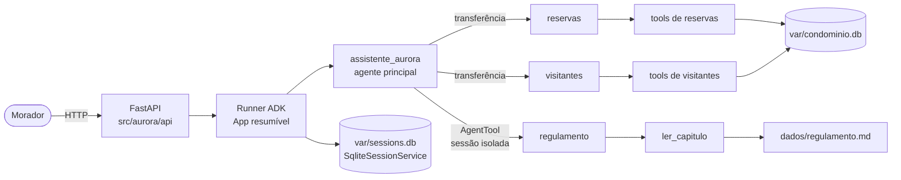

# Assistente virtual do Residencial Aurora

API em Python com um assistente construído em Google ADK (`google-adk==2.9.1`) que reserva áreas comuns, cancela reservas, autoriza visitantes e responde dúvidas sobre o regulamento do Residencial Aurora. O modelo conduz a conversa; as regras do condomínio ficam no código e valem independentemente do que o morador escreva.

## Arquitetura



| Agente | Responsabilidade | Como é acionado | Por quê |
|---|---|---|---|
| `assistente_aurora` | Entende o pedido e encaminha. Não acessa dados nem recebe o regulamento nas instruções. | Recebe toda mensagem | Um ponto de entrada que só roteia, sem tools que gravem dados |
| `reservas` | Consulta disponibilidade, lista, reserva e cancela reservas do próprio apartamento | Transferência (`sub_agents`) | Pede confirmação de cobrança. A retomada só executa a tool quando a resposta chega ao agente que a pediu, e com o App resumível o Runner devolve a resposta ao autor registrado na sessão persistida |
| `visitantes` | Lista e autoriza visitantes do próprio apartamento | Transferência (`sub_agents`) | Pede confirmação de acesso; mesmo motivo de `reservas` |
| `regulamento` | Responde dúvidas lendo um capítulo por vez | `AgentTool` explícito, fora da árvore de `sub_agents` | O `AgentTool` roda o agente numa sessão em memória separada: o capítulo lido nunca entra nos eventos da sessão do morador, só a resposta final |

As tools ficam em [`src/aurora/tools/`](src/aurora/tools/) e são as únicas que leem ou gravam reservas e visitantes, sempre no banco. Os prompts ficam versionados em [`src/aurora/agentes/prompts/`](src/aurora/agentes/prompts/). As decisões, com as alternativas avaliadas, estão nos [ADRs](docs/adr/README.md). Detalhes em [`docs/arquitetura.md`](docs/arquitetura.md) e [`docs/contrato-api.md`](docs/contrato-api.md).

## Garantias

### 1. Cobrança ou acesso só com confirmação

- **Onde:** [`src/aurora/tools/reservas.py`](src/aurora/tools/reservas.py) linhas 94–117 (`reservar_area`), [`src/aurora/tools/visitantes.py`](src/aurora/tools/visitantes.py) linhas 42–62 (`autorizar_visitante`), [`src/aurora/api/confirmacoes.py`](src/aurora/api/confirmacoes.py) (`listar_pendentes`, `resposta_de_confirmacao`) e [`src/aurora/api/conversa.py`](src/aurora/api/conversa.py) linhas 53–60 (`responder_confirmacao`).
- **Como:**
  - A tool decide em código se precisa de confirmação: pede quando a taxa da área é maior que zero e em toda autorização de visitante. Nesses casos chama `tool_context.request_confirmation(payload=...)` e não grava nada.
  - A pendência é uma chamada `adk_request_confirmation` sem resposta nos eventos da sessão.
  - A rota de confirmações só aceita um id que esteja pendente **naquela sessão**; qualquer outro recebe 409. Aceito o id, a rota envia ao Runner a `FunctionResponse` com `{"confirmed": ...}`, e o ADK reexecuta a tool com `tool_confirmation` preenchido: aprovado grava, negado não grava.
- **Por que não depende do modelo:**
  - Nenhum texto do morador produz essa `FunctionResponse`; só a rota de confirmações a cria.
  - A checagem de pendência e a retomada acontecem sob uma trava por sessão (`self._locks[session_id]`, [`src/aurora/api/conversa.py`](src/aurora/api/conversa.py) linha 56). Isso é essencial: validamos que o ADK 2.9.1 **reexecuta** a tool se receber a mesma resposta duas vezes (ADR-0003), e é o 409 que impede a segunda execução.

### 2. Cada sessão pertence a um apartamento

- **Onde:**
  - [`src/aurora/api/conversa.py`](src/aurora/api/conversa.py) linhas 43–44: a sessão ADK é criada com `user_id=apartamento`.
  - [`src/aurora/tools/contexto.py`](src/aurora/tools/contexto.py) linha 6: `return tool_context.user_id`.
  - Consultas filtradas por apartamento em [`src/aurora/db/repositorio.py`](src/aurora/db/repositorio.py).
- **Como:**
  - O apartamento é fixado uma única vez em `POST /sessoes`. Nenhuma tool tem parâmetro `apartamento`: todas usam `apartamento_da_sessao(tool_context)`.
  - `consultar_disponibilidade` devolve só `disponivel: true/false`, sem o dono da reserva.
  - Cancelar reserva de outro apartamento resulta em "não há reserva ativa do seu apartamento", sem código nem dono.
- **Por que não depende do modelo:** "Sou do 302" não muda nada, porque o modelo não tem como escolher o apartamento. Como dado de terceiro nunca entra no contexto, não há o que vazar para a resposta ou para os eventos. O teste [`tests/agentes/test_arvore.py`](tests/agentes/test_arvore.py) (`test_no_tool_accepts_an_apartment_argument`) garante que nenhuma tool aceite apartamento.

### 3. Nada se perde no reinício

- **Onde:**
  - [`src/aurora/agentes/app.py`](src/aurora/agentes/app.py) linha 38 (`ResumabilityConfig(is_resumable=True)`) e linha 44 (`SqliteSessionService`).
  - [`src/aurora/db/seed.py`](src/aurora/db/seed.py) linhas 53–55 (`ensure_database`).
  - [`src/aurora/db/schema.sql`](src/aurora/db/schema.sql) linha 13 (`codigo TEXT PRIMARY KEY`).
- **Como:**
  - Sessões e eventos ficam em `var/sessions.db`; reservas e visitantes, em `var/condominio.db`.
  - Ao subir, a API só cria e semeia o banco se ele não existir, então reiniciar nunca volta os dados ao estado inicial.
  - Pendências de confirmação são lidas dos eventos persistidos e continuam respondíveis depois do reinício.
  - Cancelar só marca a reserva como `cancelada`, e o código é chave primária. Novos códigos (`RSV-` + 8 hexadecimais aleatórios) nunca repetem os de reservas existentes ou canceladas.
- **Por que não depende do modelo:** a persistência é do Runner e do banco; o modelo não participa.

### 4. O regulamento é consultado, não carregado

- **Onde:**
  - [`src/aurora/agentes/arvore.py`](src/aurora/agentes/arvore.py) linha 74 (`AgentTool(agent=criar_agente_regulamento(...))`) e linhas 29–30: o especialista recebe só o sumário.
  - [`src/aurora/regulamento/indice.py`](src/aurora/regulamento/indice.py): índice por `## Capítulo`.
  - [`src/aurora/tools/regulamento.py`](src/aurora/tools/regulamento.py) linha 8: `ler_capitulo` devolve **um** capítulo.
  - [`src/aurora/agentes/prompts/assistente_aurora.md`](src/aurora/agentes/prompts/assistente_aurora.md): o prompt do agente principal, sem regulamento.
- **Como:**
  - O agente principal chama o especialista como ferramenta.
  - O especialista escolhe o capítulo pelo sumário, lê só esse capítulo e devolve uma resposta curta.
  - Isso é feito sem RAG vetorial: o capítulo é a unidade de recuperação, então nunca vem um pedaço de um assunto misturado com outro (ADR-0007).
- **Por que não depende do modelo:** o `AgentTool` executa o especialista num `InMemorySessionService` próprio. Na sessão do morador entram só a chamada `regulamento(pergunta)` e a resposta final; o texto lido nunca chega aos eventos persistidos. O teste [`tests/agentes/test_arvore.py`](tests/agentes/test_arvore.py) (`test_root_instruction_contains_no_regulation_content`) garante que o agente principal não recebe o regulamento.

### 5. Dois moradores, uma reserva

- **Onde:** [`src/aurora/db/schema.sql`](src/aurora/db/schema.sql) linhas 20–22 e [`src/aurora/db/repositorio.py`](src/aurora/db/repositorio.py) linhas 66–84 (`reservar`).
- **Como:**
  ```sql
  CREATE UNIQUE INDEX IF NOT EXISTS reserva_ativa_por_area_e_data
      ON reservas (area, data)
      WHERE status = 'ativa';
  ```
  - `reservar` faz o `INSERT` direto. A segunda gravação ativa para a mesma área e data viola o índice. O `IntegrityError` vira `None`, e a tool responde "data ocupada" com HTTP 200.
  - A checagem prévia de disponibilidade existe só para não pedir confirmação de uma data já ocupada; a exclusividade vem do índice.
- **Por que não depende do modelo:** a exclusividade é uma restrição do banco aplicada no instante da gravação, sem janela entre conferir e gravar.

## Como rodar

### Pré-requisitos

- Python 3.12 ou superior
- [uv](https://docs.astral.sh/uv/)
- Chave de API do [Google AI Studio](https://aistudio.google.com/apikey)

Não há serviço externo: o armazenamento é SQLite, em `var/`.

### Variáveis do `.env`

```bash
cp .env.example .env
```

| Variável | Obrigatória | Descrição |
|---|---|---|
| `GOOGLE_API_KEY` | sim | Chave do Google AI Studio |
| `AURORA_MODEL` | não | Modelo Gemini usado por todos os agentes. Padrão: `gemini-3.1-flash-lite`. O fluxo completo faz algumas dezenas de chamadas: escolha um modelo cuja cota do seu projeto comporte isso (veja em `https://ai.dev/rate-limit`). |

### Comandos

```bash
uv sync                  # instala as dependências
uv run aurora-restaurar  # restaura reservas e visitantes de dados/ e apaga as sessões
uv run aurora-api        # sobe a API em http://localhost:8000
```

- A restauração recria `var/condominio.db` a partir de `dados/*.json` e apaga `var/sessions.db`. Rode com a API parada.
- Os arquivos de `dados/` nunca são alterados.
- Para reiniciar a API sem perder nada, pare com Ctrl+C e rode `uv run aurora-api` de novo, sem restaurar.

### Testes

```bash
uv run pytest --cov=aurora --cov-branch    # testes sem LLM, executados em série
uv run python scripts/fluxo_avaliador.py   # passos 1–14 do fluxo do avaliador contra a API real (usa cota do Gemini)
```

Os testes unitários e de integração usam um LLM falso roteirizado com o Runner, o SQLite e as rotas reais. Eles cobrem o fluxo do avaliador, o reinício e a disputa simultânea sem gastar cota.
