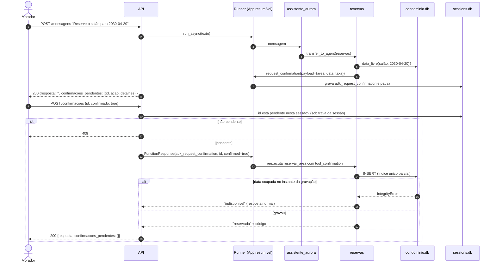
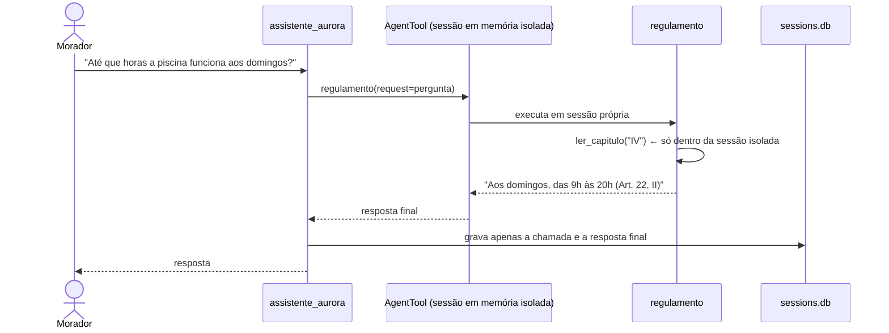

# Arquitetura

Visão geral e responsabilidades de cada agente estão no [README](../README.md#arquitetura). Este documento detalha os fluxos e a organização do código. As decisões estão nos [ADRs](adr/README.md).

## Componentes

| Camada | Módulo | Responsabilidade |
|---|---|---|
| API | `src/aurora/api/main.py` | Rotas FastAPI, mapeamento de exceções para 404/409/503 |
| API | `src/aurora/api/conversa.py` | `ServicoConversa`: cria sessões, executa o Runner sob trava por sessão, valida confirmações |
| API | `src/aurora/api/confirmacoes.py` | Deriva pendências dos eventos; monta a `FunctionResponse` de confirmação |
| Agentes | `src/aurora/agentes/arvore.py` | Árvore de agentes e forma de acionamento |
| Agentes | `src/aurora/agentes/app.py` | `App` resumível, modelo Gemini com retry/timeout, `Runner` com `SqliteSessionService` |
| Agentes | `src/aurora/agentes/prompts/*.md` | Prompts versionados |
| Tools | `src/aurora/tools/` | Únicas portas de leitura e escrita de reservas e visitantes; apartamento sempre da sessão |
| Domínio | `src/aurora/dominio.py` | Entidades e validação de datas |
| Dados | `src/aurora/db/` | Schema, restauração, repositório com exclusividade no banco |
| Regulamento | `src/aurora/regulamento/indice.py` | Índice por capítulo de `dados/regulamento.md` |
| CLI | `src/aurora/cli.py` | `aurora-restaurar` e `aurora-api` |

## Fluxo de uma reserva com cobrança

## Fluxo de uma dúvida sobre o regulamento

## Validações realizadas

| Validação | Resultado | Registro |
|---|---|---|
| Spike de confirmação com reinício de processo | Aprovar e negar funcionam após reinício; reenvio sem a checagem da API reexecuta a tool | ADR-0003 |
| Spike de isolamento do `AgentTool` | Texto do capítulo ausente dos eventos da sessão pai | ADR-0002 |
| Spike de concorrência | Duas aprovações simultâneas, sempre 1 reserva ativa | ADR-0004 |
| Testes sem LLM (`uv run pytest`) | 88 testes, cobertura ≥ 80% | ADR-0013 |
| Fluxo do avaliador com Gemini real (`scripts/fluxo_avaliador.py`) | Passos 1–14 aprovados com `gemini-3.1-flash-lite` | ADR-0009 |
